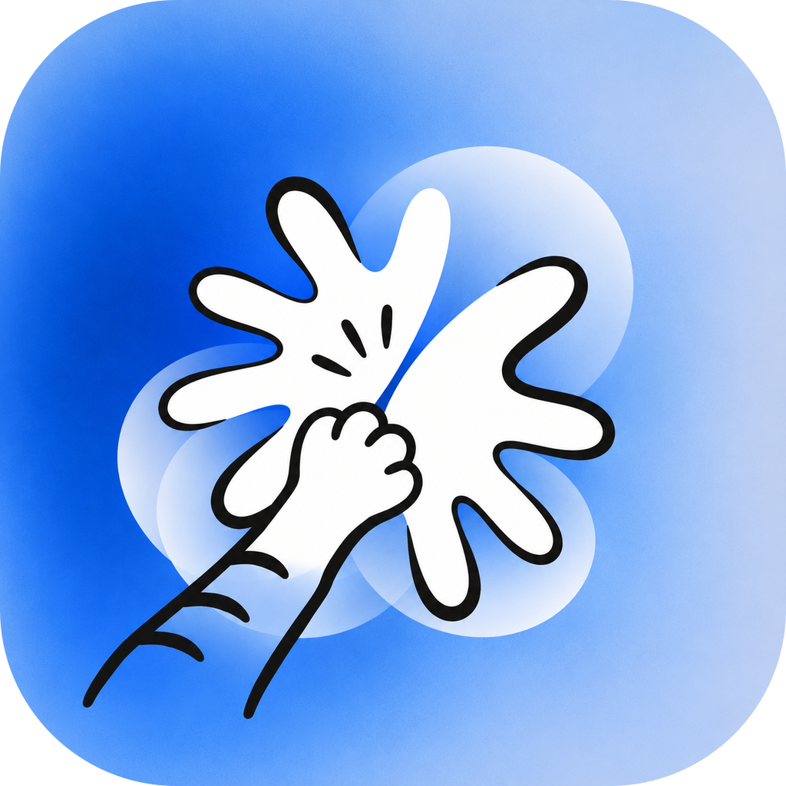
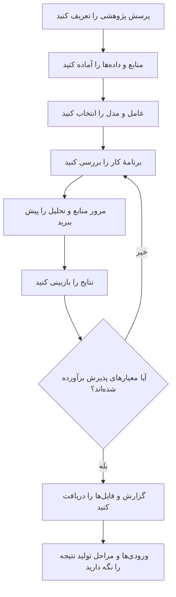
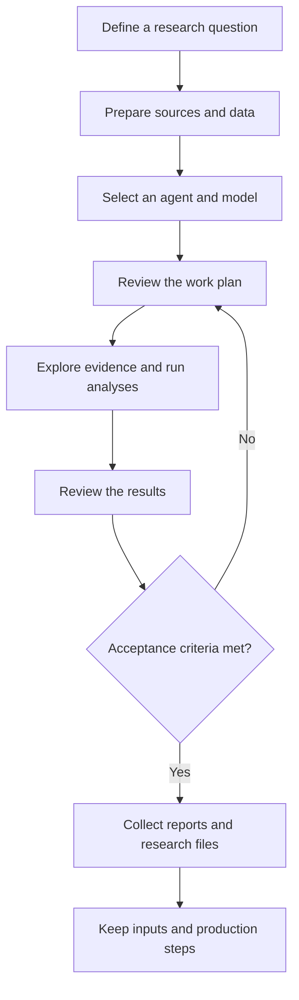

<p align="center">
  
</p>
<h1 align="center" dir="rtl"> میز کار علم پارسی - Persian Science </h1>

<p align="center" dir="rtl">
  <strong>پرسش پژوهشی خود را به شواهد، تحلیل و نتیجهٔ قابل بررسی تبدیل کنید.</strong>
</p>

<p align="center" dir="ltr">
  <a href="#persian">فارسی</a>
  ·
  <a href="#english">English</a>
</p>

<p align="center" dir="ltr">
  <a href="https://github.com/Ho3seinTork/Persian-Science/releases">
    
  </a>
  <a href="#quick-start-fa">
    
  </a>
  <a href="https://github.com/Ho3seinTork/Persian-Science/issues">
    
  </a>
  <a href="#contribute-fa">
    
  </a>
  <a href="https://reymit.ir/ho3seintork">
    
  </a>
</p>

<a id="persian"></a>

<div dir="rtl" align="right">

## 🔬 پژوهش خود را در یک فضای مشترک پیش ببرید

**میز کار علم پارسی** یک محیط پژوهشی متن‌باز است که پرسش‌ها، مقاله‌ها، داده‌ها، عامل‌های هوش مصنوعی و ابزارهای تحلیل را در زمینهٔ یک پروژه گردآوری می‌کند.

با تعریف یک مسئله و افزودن منابع مرتبط، می‌توانید مرور پیشینه، تحلیل داده، توسعهٔ کد، بازبینی و آماده‌سازی خروجی‌های پژوهشی را در یک جریان کار دنبال کنید.

این پروژه بر پایهٔ [اوپن‌ساینس](https://github.com/AIPOCH/Open-Science) توسعه می‌یابد و بر تجربهٔ فارسی، چیدمان راست‌به‌چپ و امکان انتخاب مدل و زیرساخت تمرکز دارد.

### چرا این پروژه را ساختیم؟

تجربهٔ مسدودشدن حساب‌ها و محدودیت دسترسی کاربران ایرانی به خدمات کلودِ انتروپیک، یکی از انگیزه‌های اصلی ساخت این پروژه بوده است.

این میزکار را با هدف فراهم‌کردن انتخاب‌های بیشتر برای پژوهشگران فارسی‌زبان ساخته‌ایم تا بتوانند از اتصال‌های پشتیبانی‌شده، ارائه‌دهندگان مختلف و مدل‌های محلی استفاده کنند.

دسترسی به هر سرویس همچنان به شرایط ارائه‌دهنده و امکانات حساب کاربری بستگی دارد؛ انتخاب مدل محلی نیز می‌تواند وابستگی به بعضی سرویس‌های برخط را کاهش دهد.

### سه محور اصلی را دنبال می‌کنیم

- **تجربهٔ فارسی و راست‌به‌چپ**، کار با محتوای فارسی را آسان‌تر می‌کند.
- **انتخاب مدل و زیرساخت**، امکان استفاده از سرویس‌های سازگار و مدل‌های محلی را فراهم می‌کند.
- **عامل‌های تخصصی و بازبینی**، به تقسیم وظایف و بررسی نتایج از دیدگاه‌های مختلف کمک می‌کنند.

> پروژه در حال توسعه است و ترجمهٔ بعضی بخش‌ها همچنان تکمیل می‌شود. امکانات هر عامل، مهارت و ابزار به نسخهٔ برنامه و پیکربندی آن بستگی دارد.

## 🤖 با عامل‌های پژوهشی کار کنید

عامل‌هایی مانند **کلود کد** و **کدکس** می‌توانند از طریق اتصال‌های پشتیبانی‌شده، در بررسی فایل‌ها، نوشتن و بازبینی کد و انجام وظایف چندمرحله‌ای کمک کنند.

برای دریافت نتیجهٔ بهتر، هدف، ورودی‌ها، محدودیت‌ها و خروجی مورد انتظار را به‌روشنی مشخص کنید.

</div>

<p align="center">
  
</p>

<div dir="rtl" align="right">

## 🧭 راهنمای این صفحه را دنبال کنید

- [نصب و شروع کار را بخوانید.](#quick-start-fa)
- [نحوهٔ کار میزکار را بشناسید.](#workflow-fa)
- [عامل‌ها و مدل‌ها را پیکربندی کنید.](#agents-fa)
- [از زیرعامل‌ها و میزگرد استفاده کنید.](#roundtable-fa)
- [قابلیت‌های پژوهشی را بررسی کنید.](#features-fa)
- [با اسکیل‌ها و ابزارها کار کنید.](#skills-fa)
- [نمونه‌های کاربردی را اجرا کنید.](#examples-fa)
- [گزینه‌های مختلف را مقایسه کنید.](#comparison-fa)
- [در توسعهٔ پروژه مشارکت کنید.](#contribute-fa)

<a id="quick-start-fa"></a>

## 🚀 برنامه را نصب کنید و نخستین پروژه را بسازید

### ۱. فایل نصب ویندوز را دریافت کنید

برای دریافت فایل نصب ویندوز، به [صفحهٔ ریلیزها](https://github.com/Ho3seinTork/Persian-Science/releases) مراجعه کنید و فایل دارای پسوند `.exe` را از بخش `Assets` دریافت کنید.

فایل را اجرا کنید و مراحل نصب را دنبال کنید.

### ۲. عامل یا مدل را آماده کنید

پس از اجرای برنامه، یک اتصال پشتیبانی‌شده را انتخاب کنید و اطلاعات موردنیاز آن را تنظیم کنید.

پیش از آغاز پژوهش اصلی، اتصال را با خواندن یک فایل نمونه یا اجرای یک درخواست کوتاه آزمایش کنید.

### ۳. پروژه‌ای با پرسش مشخص بسازید

مقاله‌ها، داده‌ها و فایل‌های مرتبط را به پروژه اضافه کنید و هدف پژوهش را بنویسید.

برای نمونه، می‌توانید چنین درخواستی را مطرح کنید:

> روش‌های استفاده‌شده در مقاله‌های پیوست را مقایسه کن و محدودیت‌های مقایسهٔ نتایج آن‌ها را توضیح بده.

### ۴. خروجی و معیار پذیرش را تعیین کنید

مشخص کنید که چه نتیجه‌ای می‌خواهید و چگونه آن را بررسی خواهید کرد.

</div>

<div dir="rtl" align="right">

> **پرسش:** چه موضوعی باید بررسی شود؟
>
> **ورودی‌ها:** از کدام مقاله‌ها، داده‌ها یا فایل‌ها باید استفاده شود؟
>
> **محدودیت‌ها:** کدام روش‌ها، منابع و عملیات مجاز هستند؟
>
> **خروجی:** چه جدول، نمودار، کد یا گزارشی باید تولید شود؟
>
> **معیار پذیرش:** نتیجه با چه شواهد و آزمون‌هایی باید بررسی شود؟

### ۵. کار را مرحله‌به‌مرحله بررسی کنید

برنامهٔ پیشنهادی، درخواست‌های دسترسی و خروجی هر مرحله را بررسی کنید.

در پایان، از بازبین بخواهید منابع، فرض‌ها، محاسبات و نتیجه‌گیری‌ها را نقد کند.

### برنامه را از سورس اجرا کنید

برای اجرای نسخهٔ سورس، ابتدا گیت، نود نسخهٔ ۲۴ و مدیر بستهٔ موردنیاز را آماده کنید.

سپس [پیش‌نیازهای پلتفرم](docs/development-quick-reference.md) را بررسی کنید و فرمان‌های زیر را اجرا کنید.

</div>

<div dir="ltr" align="left">

```bash
git clone https://github.com/Ho3seinTork/Persian-Science.git
cd Persian-Science
npm ci
npm run dev
```

</div>

<div dir="rtl" align="right">

برای دریافت اطلاعات بیشتر، [راهنمای راه‌اندازی](docs/PERSIAN_SCIENCE_SETUP.md) را مطالعه کنید.

</div>

<p align="center">
  
</p>

<div dir="rtl" align="right">

<a id="workflow-fa"></a>

## ⚙️ میزکار چگونه کار می‌کند؟

این برنامه یک **هارنس پژوهشی** است که زمینهٔ پروژه، عامل‌ها، مدل‌ها و ابزارها را به یکدیگر متصل می‌کند.

- **مدل**، پاسخ‌ها و پیشنهادها را تولید می‌کند.
- **عامل**، با کمک مدل و ابزارهای در دسترس، وظیفه را دنبال می‌کند.
- **ابزار**، عملیاتی مانند خواندن فایل یا اجرای کد را انجام می‌دهد.
- **اسکیل یا مهارت**، روش تخصصی انجام یک نوع کار را فراهم می‌کند.
- **هارنس**، زمینهٔ پروژه، اتصال‌ها و روند اجرا را هماهنگ می‌کند.
- **پژوهشگر**، هدف، معیار پذیرش و تصمیم نهایی را تعیین می‌کند.

</div>



<div dir="rtl" align="right">

برای ارزیابی نتیجه، داده‌های مبنا، منابع، کد و مراحل تولید آن را همراه یکدیگر بررسی کنید.

<a id="agents-fa"></a>

## 🧠 عامل‌ها و مدل‌ها را متناسب با کار انتخاب کنید

### از کلود کد استفاده کنید

کلود کد می‌تواند در اتصال‌های پشتیبانی‌شده، برای کارهای چندمرحله‌ای شامل بررسی فایل‌ها، استفاده از ابزارها و آماده‌سازی خروجی به کار گرفته شود.

ابتدا یک وظیفهٔ کوچک همراه فایل‌های مرتبط و خروجی روشن تعریف کنید و توانایی اتصال را بررسی کنید.

برای مطالعهٔ پیش‌نیازها و روش رسمی دسترسی، [مستندات کلود کد](https://github.com/anthropics/claude-code) را ببینید.

### از کدکس استفاده کنید

کدکس می‌تواند در توسعه، توضیح، اصلاح و بازبینی کدهای پژوهشی کمک کند.

کد، رفتار مورد انتظار و یک ورودی نمونه را ارائه کنید و از عامل بخواهید اصلاحات را همراه دلیل و آزمون توضیح دهد.

برای مطالعهٔ پیش‌نیازها و روش رسمی دسترسی، [مستندات کدکس](https://github.com/openai/codex) را ببینید.

### مدل محلی یا سرویس سفارشی را متصل کنید

برای استفاده از مدل محلی، یک سرویس سازگار را اجرا کنید و اتصال پشتیبانی‌شدهٔ آن را در برنامه تنظیم کنید.

سرویس‌هایی مانند اولاما، ال‌ام استودیو و وی‌ال‌ال‌ام می‌توانند بخشی از این راه‌اندازی باشند.

پس از تنظیم نشانی سرویس و مدل، پاسخ ساده و فراخوانی ابزار را جداگانه آزمایش کنید.

اجرای مدل روی دستگاه خودتان، به‌تنهایی همهٔ ابزارهای متصل را آفلاین نمی‌کند.

### مراحل اتصال را دنبال کنید

1. اتصال موجود در نسخهٔ برنامه را انتخاب کنید.
2. پیش‌نیازهای همان عامل یا سرویس را آماده کنید.
3. روش احراز هویت پشتیبانی‌شده را تنظیم کنید.
4. مدل و گزینه‌های اتصال را مشخص کنید.
5. خواندن یک فایل نمونه را آزمایش کنید.
6. ابزار موردنیاز را با یک کار کوچک بررسی کنید.
7. پس از ارزیابی نتیجه، پژوهش اصلی را آغاز کنید.

اشتراک محصول، ورود حساب و کلید رابط برنامه‌نویسی ممکن است روش‌های متفاوتی برای دسترسی باشند؛ روش پذیرفته‌شدهٔ اتصال انتخابی را بررسی کنید.

برای جزئیات بیشتر، [راهنمای مدل‌ها و ارائه‌دهندگان](docs/MODEL_PROVIDER_SPEC.md) را مطالعه کنید.

<a id="roundtable-fa"></a>

## 🗣️ با زیرعامل‌ها و میزگرد، مسئله را از چند دیدگاه بررسی کنید

عامل اصلی، هدف کلی را دنبال می‌کند و نتایج را جمع‌بندی می‌کند.

زیرعامل‌ها یا عامل‌های تخصصی، روی مسئولیت‌های محدودتری مانند بررسی منابع، تحلیل داده یا نقد روش تمرکز می‌کنند.

در گردش‌کار میزگرد، نقش‌های مختلف یک پرسش مشترک را بررسی می‌کنند و شواهد، توافق‌ها و اختلاف‌ها در جمع‌بندی قرار می‌گیرند.

</div>

<p align="center">
  
</p>

<div dir="rtl" align="right">

### مسئولیت هر نقش را مشخص کنید

- **متخصص موضوع**، مفاهیم و ارتباط پرسش با دانش حوزه را بررسی می‌کند.
- **مرورگر منابع**، شواهد مرتبط و تفاوت یافته‌ها را استخراج می‌کند.
- **روش‌شناس**، طراحی مطالعه، متغیرها و فرض‌ها را نقد می‌کند.
- **تحلیل‌گر داده**، داده‌ها، محاسبات و نمودارها را بررسی می‌کند.
- **بازبین**، ناسازگاری‌ها و تفسیرهای جایگزین را جست‌وجو می‌کند.

این نقش‌ها نمونه‌هایی برای تقسیم کار هستند و امکانات اجرایی آن‌ها به نسخه و پیکربندی برنامه بستگی دارد.

### درخواست میزگرد را روشن بنویسید

> این طرح پژوهش را از سه دیدگاه بررسی کن.
>
> متخصص موضوع، اهمیت پرسش و شواهد مرتبط را بررسی کند.
>
> روش‌شناس، طراحی و تهدیدهای اعتبار را نقد کند.
>
> بازبین، تفسیرهای جایگزین و نقاط ضعف را مشخص کند.
>
> در جمع‌بندی، توافق‌ها و اختلاف‌ها را جدا بنویس.
>
> برای هر ادعا، شاهد یا فرض مربوط را مشخص کن.
>
> پرسش‌های حل‌نشده و اقدام بعدی را نیز توضیح بده.

توافق چند عامل، به‌تنهایی صحت علمی را اثبات نمی‌کند؛ نتیجه را با داده، منبع و روش پژوهش ارزیابی کنید.

<a id="features-fa"></a>

## 📚 قابلیت‌ها را در مراحل پژوهش به کار بگیرید

### پروژه‌ها و نشست‌ها را سازمان‌دهی کنید

فایل‌ها و گفتگوهای مربوط به یک مسئله را در پروژهٔ مرتبط نگه دارید و برای هر نشست هدف مشخصی تعیین کنید.

این کار، زمینهٔ پژوهش را حفظ می‌کند و ادامهٔ کار را آسان‌تر می‌کند.

### منابع را جست‌وجو و غربال کنید

پرسش، کلیدواژه‌ها و معیارهای ورود و خروج را تعریف کنید و یافته‌ها را به جدول شواهد تبدیل کنید.

این روش، مرور پیشینه را منظم‌تر می‌کند و مقایسهٔ مطالعات را آسان‌تر می‌کند.

### مقاله‌ها و فایل‌های پی‌دی‌اف را بررسی کنید

دربارهٔ روش، یافته‌ها و محدودیت‌های مقاله، پرسش مشخص مطرح کنید و محل شواهد را درخواست کنید.

در صورت استفاده از ترجمهٔ پشتیبانی‌شده، بخش‌های مهم را با متن اصلی تطبیق دهید.

این قابلیت‌ها به فهم منابع و استخراج اطلاعات مرتبط کمک می‌کنند.

### منابع و استنادها را پیگیری کنید

مشخصات منابع را نگه دارید و ارتباط هر ادعا با مرجع مربوط را بررسی کنید.

این کار، منشأ اطلاعات را روشن می‌کند و کنترل کیفیت نگارش را آسان‌تر می‌کند.

### تحلیل را در نوت‌بوک پیش ببرید

داده‌ها، توضیح متغیرها و پرسش تحلیلی را معرفی کنید و کد و خروجی را مرحله‌به‌مرحله بررسی کنید.

این روش، مسیر تبدیل داده به نتیجه را قابل مشاهده می‌کند.

### نمودارها و خروجی‌ها را بررسی کنید

نوع نمایش را متناسب با پرسش انتخاب کنید و عنوان، واحد، مقیاس و توضیح نمودار را بررسی کنید.

برای دریافت خروجی مناسب، قالب موردنیاز را از ابتدا مشخص کنید.

این کار، تفسیر یافته‌ها و استفاده از فایل نهایی را آسان‌تر می‌کند.

### از ابزارها و میزبان‌های محاسباتی استفاده کنید

سرویس یا میزبان پشتیبانی‌شده را پیکربندی کنید و ابتدا یک اجرای کوچک انجام دهید.

این قابلیت، استفاده از داده‌ها، عملیات و منابع محاسباتی متناسب با کار را فراهم می‌کند.

### مراحل تولید نتیجه را نگه دارید

ورودی‌ها، کد، تنظیمات مؤثر و مراحل اجرا را همراه خروجی ذخیره کنید.

این کار، بازبینی، تکرار تحلیل و یافتن منشأ خطا را آسان‌تر می‌کند.

</div>

<p align="center">
  
</p>

<div dir="rtl" align="right">

<a id="skills-fa"></a>

## 🧩 از اسکیل‌ها و ابزارها استفاده کنید

### اسکیل چگونه کار می‌کند؟

اسکیل، دستورالعملی تخصصی و قابل استفادهٔ مجدد است که روش انجام یک نوع کار را توضیح می‌دهد.

ابزار، عملیات را اجرا می‌کند و عامل، با کمک مدل و در محدودهٔ دسترسی‌های خود، از مهارت و ابزار استفاده می‌کند.

مهارت‌های همراه سورس را از [پوشهٔ اسکیل‌های پروژه](resources/skills) بررسی کنید.

نام و دسترسی هر مهارت را از فهرست نسخهٔ نصب‌شده بررسی کنید؛ کاربردهای زیر، نمونه‌هایی برای انتخاب مهارت مناسب هستند.

### مهارت مناسب را انتخاب کنید

1. خروجی موردنیاز را مشخص کنید.
2. توضیح، ورودی‌ها و پیش‌نیازهای مهارت را بخوانید.
3. داده‌ها و فایل‌های لازم را آماده کنید.
4. نرم‌افزارها و اتصال‌های موردنیاز را تنظیم کنید.
5. از روش فعال‌سازی پشتیبانی‌شدهٔ برنامه استفاده کنید.
6. یک نمونهٔ کوچک را اجرا کنید.
7. نتیجه را با معیارهای پژوهش ارزیابی کنید.

نصب یک مهارت، به‌تنهایی نرم‌افزار، داده یا اعتبارنامهٔ موردنیاز آن را فراهم نمی‌کند.

### مهارت‌ها را متناسب با مرحلهٔ پژوهش به کار ببرید

- **برای مرور منابع،** پرسش و معیارهای انتخاب را ارائه کنید و جدول مقایسه و شکاف‌های پژوهش را بخواهید.
- **برای استخراج شواهد،** مقاله‌ها و اطلاعات موردنیاز را مشخص کنید و داده‌های ساختاریافته همراه مشخصات منبع را بخواهید.
- **برای نقد روش،** فرضیه، طراحی و متغیرها را توضیح دهید و محدودیت‌ها و اصلاحات پیشنهادی را بخواهید.
- **برای بررسی کیفیت داده،** داده و فرهنگ متغیرها را ارائه کنید و گزارش ناسازگاری‌ها و داده‌های گمشده را بخواهید.
- **برای تحلیل و مصورسازی،** پرسش تحلیلی را مشخص کنید و کد، جدول، نمودار و محدودیت‌ها را بخواهید.
- **برای بازبینی کد،** رفتار مورد انتظار را توضیح دهید و اصلاحات همراه آزمون را بخواهید.
- **برای نگارش و ترجمه،** منابع، مخاطب، زبان و ساختار متن را مشخص کنید و پیش‌نویس قابل بازبینی را بخواهید.
- **برای بررسی استنادها،** متن و فهرست منابع را ارائه کنید و موارد نیازمند اصلاح یا شاهد بیشتر را بخواهید.
- **برای بازتولیدپذیری،** کد، دادهٔ مجاز و مراحل اجرا را گردآوری کنید و راهنمای اجرای تحلیل را بخواهید.

<a id="examples-fa"></a>

## 🧪 نمونه‌های کاربردی را امتحان کنید

### مقاله‌ها را به جدول شواهد تبدیل کنید

> مقاله‌های پیوست را با توجه به پرسش پروژه مقایسه کن.
>
> برای هر مقاله، هدف، طراحی، نمونه، روش تحلیل و یافته‌ها را استخراج کن.
>
> محدودیت‌ها و مشخصات منبع را نیز بنویس.
>
> فقط اطلاعات موجود در مقاله را گزارش کن و اطلاعات گزارش‌نشده را مشخص کن.
>
> در پایان، اختلاف یافته‌ها و دشواری‌های مقایسه را توضیح بده.
>
> یک جدول شواهد و یک خلاصهٔ تحلیلی تحویل بده.

این گردش‌کار به مرور منابع و مقایسهٔ مطالعات کمک می‌کند.

### داده‌ها را به گزارش تحلیل تبدیل کنید

> ابتدا ساختار و کیفیت دادهٔ پیوست را بررسی کن.
>
> داده‌های گمشده و فرض‌های روش را پیش از تحلیل مشخص کن.
>
> تبدیل‌های داده را ثبت کن.
>
> برای هر نمودار، عنوان، واحد و روش تولید را توضیح بده.
>
> کد تولید هر نتیجه را همراه آن نگه دار.
>
> یافته‌ها و محدودیت‌ها را در گزارش نهایی جدا بنویس.

این گردش‌کار به تحلیل قابل بررسی و آماده‌سازی گزارش کمک می‌کند.

<a id="comparison-fa"></a>

## 🔎 گزینه‌ها را متناسب با نیاز خود مقایسه کنید

### نسبت به اوپن‌ساینس چه تفاوتی داریم؟

این پروژه بر پایهٔ اوپن‌ساینس توسعه می‌یابد و از قابلیت‌های پژوهشی آن استفاده می‌کند.

تفاوت اصلی، تمرکز بر تجربهٔ فارسی، راست‌به‌چپ و مشارکت جامعهٔ فارسی‌زبان است.

عامل‌ها، نوت‌بوک و ابزارهای منابع علمی، بخشی از پایهٔ مشترک هستند و مزیت انحصاری این نسخه محسوب نمی‌شوند.

### نسبت به گردش‌کارهای علمی کلود چه تفاوتی داریم؟

تمرکز این میزکار بر سازمان‌دهی پروژه، امکان انتخاب اتصال‌های مختلف و استفاده از سرویس‌های مدل محلی است.

برای پژوهشگری که تجربهٔ فارسی و انتخاب زیرساخت برای او اهمیت دارد، این ویژگی‌ها می‌توانند مزیت عملی ایجاد کنند.

کیفیت نتیجه به مدل، داده، ابزار و روش پژوهش بستگی دارد؛ برتری عمومی در دقت، سرعت یا هزینه به ارزیابی مقایسه‌ای نیاز دارد.

## ❓ پاسخ پرسش‌های رایج را بخوانید

### آیا استفاده از برنامه رایگان است؟

کد پروژه تحت مجوز آپاچی نسخهٔ ۲ ارائه می‌شود.

سرویس‌های مدل، زیرساخت محاسباتی و ابزارهای اختیاری ممکن است هزینه یا شرایط استفادهٔ جداگانه داشته باشند.

### آیا می‌توان بدون سرویس خارجی کار کرد؟

در اتصال‌های سازگار، امکان استفاده از مدل محلی وجود دارد.

بعضی ابزارها، مانند دریافت منابع برخط، ممکن است همچنان به اینترنت نیاز داشته باشند.

### آیا تمام رابط فارسی است؟

پشتیبانی فارسی و راست‌به‌چپ در پروژه وجود دارد و ترجمه‌ها همچنان تکمیل می‌شوند.

بعضی بخش‌ها ممکن است به انگلیسی نمایش داده شوند.

### آیا نتیجه‌ها و استنادها باید بررسی شوند؟

عامل‌ها ممکن است اشتباه کنند.

پیش از استفادهٔ علمی، منابع، داده‌ها، محاسبات و نتیجه‌گیری‌ها را بررسی کنید.

<a id="contribute-fa"></a>

## 🤝 در توسعهٔ پروژه مشارکت کنید

- اگر پژوهشگر هستید، یک گردش‌کار واقعی یا نمونهٔ قابل بازتولید پیشنهاد کنید.
- اگر برنامه‌نویس هستید، در رفع باگ، توسعهٔ اتصال‌ها و بهبود آزمون‌ها مشارکت کنید.
- اگر مترجم هستید، به تکمیل ترجمه‌ها و یکدست‌شدن واژگان کمک کنید.
- اگر طراح هستید، خوانایی، دسترس‌پذیری و تجربهٔ راست‌به‌چپ را بررسی کنید.
- اگر کاربر هستید، تجربهٔ استفاده و نقاط مبهم راهنما را گزارش کنید.

برای شروع، [راهنمای مشارکت](CONTRIBUTING.md) را بخوانید.

### باگ‌ها را گزارش کنید

در [بخش گزارش مشکلات](https://github.com/Ho3seinTork/Persian-Science/issues)، نسخهٔ برنامه، سیستم‌عامل، عامل یا مدل مرتبط، مراحل بازتولید و متن خطا را بنویسید.

رفتار مورد انتظار و رفتار مشاهده‌شده را نیز توضیح دهید.

پیش از ارسال، اطلاعات ورود، کلیدهای دسترسی و داده‌های خصوصی را حذف کنید.

برای گزارش آسیب‌پذیری، [سیاست امنیتی](SECURITY.md) را مطالعه کنید.

## ☕ از ادامهٔ توسعه حمایت کنید

با گزارش باگ، بهبود ترجمه، نوشتن راهنما و معرفی پروژه، به ادامهٔ توسعه کمک کنید.

برای حمایت مالی، از [صفحهٔ حمایت از پروژه](https://reymit.ir/ho3seintork) استفاده کنید.

## 📖 به پروژه ارجاع دهید

اگر از این میزکار در پژوهش یا آموزش استفاده کردید، نام پروژه، نشانی مخزن و نسخه یا شناسهٔ تغییر استفاده‌شده را ذکر کنید.

برای بازتولیدپذیری، مدل، ابزارهای متصل و تنظیمات مؤثر بر تحلیل را نیز ثبت کنید.

## مجوز و قدردانی را بررسی کنید

کد پروژه تحت [مجوز آپاچی نسخهٔ ۲](LICENSE) ارائه می‌شود.

مجوز وابستگی‌ها و سرویس‌های دیگر مستقل است؛ [اطلاعات مجوزهای شخص ثالث](docs/THIRD_PARTY_LICENSES.md) را بررسی کنید.

از توسعه‌دهندگان اوپن‌ساینس، پروژهٔ فونت آراد و جامعهٔ متن‌باز قدردانی می‌کنیم.

نام‌های تجاری عامل‌ها و سرویس‌ها به ارائه‌دهندگان مربوط تعلق دارند.

</div>

---

<a id="english"></a>

<div dir="ltr" align="left">

# 🧪 A Research Workspace for Persian-Speaking Researchers

**Turn research questions into evidence, analysis and reviewable results.**

[Persian](#persian) ·
[Download](https://github.com/Ho3seinTork/Persian-Science/releases) ·
[Quick Start](#quick-start-en) ·
[Report a Bug](https://github.com/Ho3seinTork/Persian-Science/issues) ·
[Donate](https://reymit.ir/ho3seintork)

## 🔬 Bring your research into a shared workspace

**Persian Science** is an open-source research workbench built on [AIPOCH Open-Science](https://github.com/AIPOCH/Open-Science).

Keep research questions, papers, datasets, AI agents and analysis tools in a shared project context. Use them to support literature reviews, data analysis, code development, critical review and research deliverables.

Three priorities shape the experience:

- **Persian and right-to-left support** for Persian-speaking researchers.
- **Model and infrastructure choice**, including supported providers, custom APIs and local model services.
- **Specialist agents and review** for focused tasks and multiple perspectives.

### Why we built it

Account suspensions and access restrictions experienced by Iranian users of Anthropic’s Claude services were among the motivations for this project.

We wanted to give Persian-speaking researchers more choices through supported integrations, different providers and local model services.

External services remain subject to their providers’ terms and account requirements. Local models can reduce dependence on some online services.

> The project is under active development. Persian localization is still expanding. Agent, skill and tool availability depends on the version, integration and prerequisites.

<a id="quick-start-en"></a>

## 🚀 Install the application and start a project

### 1. Download the Windows installer

Visit [Releases](https://github.com/Ho3seinTork/Persian-Science/releases) and download the `.exe` installer from **Assets**.

Run the file and follow the installation steps.

### 2. Configure an agent or model

Choose a supported integration and configure its required connection and authentication settings.

Test a small request before starting the main research task.

### 3. Create a project around a question

Add relevant papers, datasets or other files. State what you want to investigate.

> Compare the methods used in the attached papers and explain what limits direct comparison of their findings.

### 4. Define your deliverable

Specify the question, inputs, constraints, expected output and acceptance criteria.

```text
Question:
What should be investigated?

Inputs:
Which papers, files or datasets should be used?

Constraints:
Which methods, sources and operations are permitted?

Deliverable:
Which tables, figures, scripts or reports should be produced?

Acceptance criteria:
Which evidence and tests should be used to evaluate the result?
```

### 5. Review the work

Inspect the proposed plan, access requests and intermediate results.

Ask a reviewer to challenge sources, assumptions, calculations and conclusions.

### Run from source

Install Git, Node.js 24 and npm. Review the [platform prerequisites](docs/development-quick-reference.md), then run:

```bash
git clone https://github.com/Ho3seinTork/Persian-Science.git
cd Persian-Science
npm ci
npm run dev
```

See the [setup guide](docs/PERSIAN_SCIENCE_SETUP.md) for details.

## ⚙️ Understand how the harness works

- A **model** generates responses and suggestions.
- An **agent** uses a model and available tools to pursue a task.
- A **tool** performs an operation, such as reading a file or running code.
- A **skill** provides reusable, task-specific instructions.
- The **harness** coordinates project context, integrations and execution.
- The **researcher** sets the objective, acceptance criteria and final decisions.



Evaluate results alongside their data, sources, code and production steps.

## 🤖 Use Claude Code, Codex and local models

### Claude Code

Supported Claude Code or Claude Agent integrations can assist with multi-step tasks involving files, tools and research outputs.

Start with a bounded task, relevant inputs and an explicit deliverable.

See the [official Claude Code repository](https://github.com/anthropics/claude-code) for prerequisites and access requirements.

### Codex

Supported Codex integrations can help draft, explain, fix and review research code.

Provide the code, expected behavior and a sample input. Ask for reasons and tests alongside proposed changes.

See the [official Codex repository](https://github.com/openai/codex) for prerequisites and access requirements.

### Local models and custom APIs

Run a compatible service and configure a supported connection.

Ollama, LM Studio and vLLM can be part of a local-model setup when their API and model capabilities match the selected integration.

Test ordinary responses and tool use separately. A local model does not automatically make every connected tool offline.

### Configure an integration

1. Select an integration available in your application version.
2. Meet its prerequisites.
3. Configure its supported authentication method.
4. Select the model and connection settings.
5. Test reading a sample file.
6. Test the required tool with a small task.
7. Inspect the result before starting larger work.

Product subscriptions, account sign-in and API keys may be different access methods. Check the method supported by your selected integration.

Read the [model and provider guide](docs/MODEL_PROVIDER_SPEC.md) for additional information.

## 🗣️ Organize subagents and research roundtables

The main agent follows the overall objective and synthesizes results. Subagents or specialists focus on bounded responsibilities.

A research roundtable examines a shared question from several perspectives and brings evidence, agreement and disagreement into a synthesis.

Suggested responsibilities include:

- A **domain specialist** examines concepts and their relationship to existing knowledge.
- A **literature reviewer** extracts relevant evidence and differences between findings.
- A **methodologist** critiques design, variables and assumptions.
- A **data analyst** inspects data, calculations and figures.
- A **reviewer** looks for inconsistencies and alternative explanations.

These are examples for organizing work. Execution options depend on the application version and configuration.

### Example roundtable request

```text
Review this proposal from three perspectives.

The domain specialist should examine relevance and supporting evidence.
The methodologist should critique design and threats to validity.
The reviewer should identify weaknesses and alternative explanations.

Separate agreement from disagreement in the synthesis.
Identify evidence or assumptions behind each claim.
Preserve unresolved questions and recommend the next action.
```

Agreement between agents is not scientific validation. Evaluate the result against data, sources and methodology.

## 📚 Apply the capabilities to research

| Capability | How to use it | Research benefit |
|---|---|---|
| Projects and sessions | Keep related files and conversations around a clear question. | Preserves context and makes work easier to resume. |
| Literature discovery and screening | Define search terms and inclusion/exclusion criteria. | Supports a structured literature review. |
| PDF reading | Ask focused questions about methods, findings and limitations. | Helps extract relevant information. |
| PDF translation | Use supported language options and compare important passages with the source. | Supports understanding of research material. |
| References and citations | Retain source metadata and verify claim-to-reference relationships. | Makes information traceable. |
| Notebooks | Define data, questions and methods; inspect code and outputs. | Makes the path from data to findings visible. |
| Figures and previews | Inspect titles, units, scales and generated files. | Improves interpretation and delivery. |
| Tools and connectors | Configure a supported service and relevant operations. | Provides access to required data and tools. |
| Compute hosts | Configure a supported host and start with a small test. | Provides computing resources appropriate to the workload. |
| Research artifacts | Specify the tables, scripts, figures or reports you need. | Produces usable deliverables. |
| Provenance and reproducibility | Keep inputs, code, relevant settings and execution steps. | Supports review, reruns and error investigation. |

## 🧩 Use skills and tools

A **skill** provides reusable instructions. A **tool** performs an operation. An **agent** uses them with a model within its available permissions.

Browse the [skills included in the source tree](resources/skills). Check actual names and availability in your installed version.

### Choose and run a skill

1. Define the deliverable.
2. Read the skill’s description, inputs and prerequisites.
3. Prepare the required files and data.
4. Configure its software and integrations.
5. Use the activation method supported by the application.
6. Run a small example.
7. Evaluate the result against research criteria.

Installing a skill does not automatically provide software, datasets or credentials.

### Match skills to research tasks

| Research task | What to provide | What to request |
|---|---|---|
| Literature review | A question and selection criteria. | A comparison table and research gaps. |
| Evidence extraction | Papers and extraction fields. | Structured evidence linked to sources. |
| Method critique | Hypotheses, design and variables. | Assumptions, limitations and suggested revisions. |
| Data-quality assessment | Data and variable definitions. | Missing-data and inconsistency reports. |
| Analysis and visualization | An analytical question and dataset. | Code, tables, figures and limitations. |
| Code review | Code and expected behavior. | Fixes and relevant tests. |
| Writing and translation | Sources, audience, language and structure. | A draft for review. |
| Citation checks | A draft and its references. | Claims requiring corrections or more evidence. |
| Reproducible delivery | Permitted data, code and execution steps. | A run guide and related files. |

## 🧪 Try a research workflow

### Turn papers into an evidence table

```text
Compare the attached papers against the project question.

Extract each paper’s objective, design, sample, method and findings.
Include limitations and source details.
Report only information present in the paper.
Identify information that was not reported.
Explain conflicting findings and barriers to direct comparison.

Deliver an evidence table and an analytical synthesis.
```

### Turn data into an analysis report

```text
Inspect the dataset’s structure and quality first.
Identify missing data and methodological assumptions before analysis.
Record data transformations.
Explain each figure’s title, units and production method.
Keep the code that produces each result.
Present findings and limitations separately.
```

## 🔎 Choose the right workspace

### Compared with Open-Science

This project builds on Open-Science and uses its research foundation.

Its main distinction is the Persian and right-to-left experience, with opportunities for Persian-speaking contributors to shape the workbench.

Agents, notebooks and literature tools belong to the shared foundation rather than being exclusive inventions of this project.

### Compared with Claude-based scientific workflows

The workbench emphasizes project organization, supported integrations and local model options.

These choices can be useful when Persian-language use and infrastructure flexibility matter to the researcher.

Results depend on models, data, tools and methods. General claims of greater accuracy, speed or lower cost require comparative evaluation.

## ❓ Frequently asked questions

### Is it free to use?

Project code is provided under Apache-2.0. Model services, compute infrastructure and optional tools may have separate charges and terms.

### Can I use a local model?

Yes, where the service API and model capabilities match the selected integration. Literature retrieval and other online tools may still require network access.

### Is the entire interface translated into Persian?

Persian and right-to-left support are present, and translations are expanding. Some sections may still appear in English.

### Should I verify findings and citations?

Yes. Agents can make mistakes. Verify sources, data, calculations and conclusions before relying on them in research.

## 🤝 Contribute

Researchers, developers, translators, designers and users are welcome.

Propose practical workflows, fix bugs, improve integrations, expand translations, review accessibility or clarify documentation.

Start with the [contributing guide](CONTRIBUTING.md).

### Report a bug

Open an [issue](https://github.com/Ho3seinTork/Persian-Science/issues) with:

1. Application and operating-system versions.
2. The relevant agent, model and integration.
3. Reproduction steps.
4. Expected and actual behavior.
5. Error text and a small shareable example.

Remove credentials, API keys and private data before posting.

For vulnerabilities, follow the [security policy](SECURITY.md).

## ☕ Support development

Report a bug, improve a translation, write a guide or introduce the project to another researcher.

You can also [support development through Reymit](https://reymit.ir/ho3seintork).

## 📖 Research attribution

If you use the workbench in research or teaching, reference the project name, repository URL and version or commit used.

For reproducibility, record the model, connected tools and settings that materially affect the analysis.

## License and acknowledgments

Project code is provided under the [Apache License 2.0](LICENSE).

Dependencies and external services have their own terms. See [third-party licenses](docs/THIRD_PARTY_LICENSES.md).

With thanks to [AIPOCH Open-Science](https://github.com/AIPOCH/Open-Science), the Arad font project and the open-source community.

Agent and service names belong to their respective providers.

</div>
