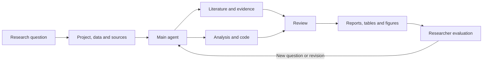

<p align="center">
  
</p>

<h1 align="center">Persian Science</h1>

<p align="center">
  <strong>From research questions to evidence, analysis and reviewable results.</strong>
</p>

<p align="center">
  A Persian-first research workspace with AI agents, configurable models and scientific tools.
</p>

<p align="center">
  <a href="#quick-start">
    
  </a>
  <a href="#agents">
    
  </a>
  <a href="#skills">
    
  </a>
  <a href="https://github.com/Ho3seinTork/Persian-Science/issues">
    
  </a>
  <a href="#support">
    
  </a>
</p>

<p align="center">
  <a href="README.md">فارسی</a> ·
  <a href="https://github.com/Ho3seinTork/Persian-Science/releases">Releases</a> ·
  <a href="CONTRIBUTING.md">Contributing</a> ·
  <a href="LICENSE">Apache-2.0</a>
</p>

<p align="center">
  
</p>

## Your research, in a shared workspace

**Persian Science** is an open-source research workbench built on
[AIPOCH Open-Science](https://github.com/AIPOCH/Open-Science).

Bring your research question, papers, datasets, conversations, analysis code and outputs into a shared project context. Use AI agents to help examine the literature, compare evidence, develop analyses, review code and prepare research deliverables.

Three priorities:

- **Persian and right-to-left support:** a workspace designed around Persian-language use, with left-to-right presentation for code and technical content.
- **Choice of models and infrastructure:** supported providers, custom APIs and local model services.
- **Specialization and review:** a main agent, specialist agents and reviewers for different parts of a research task.

> The project is under active development. Persian localization is still being expanded. Agent, tool and service availability depends on the application version and configuration.

<table>
  <tr>
    <td align="center">
      <strong>Image 1 — Claude Code and Codex in Persian Science</strong><br/>
      <sub>Selecting an agent, working with project files and inspecting research outputs</sub>
    </td>
  </tr>
</table>

<!--
Replace the placeholder above with your actual screenshot or recorded demo:

<p align="center">
  
</p>

Use PNG/WebP for a screenshot or GIF for an actual recorded demonstration.
-->

## On this page

- [Research capabilities](#features)
- [How it works](#workflow)
- [Quick start](#quick-start)
- [Claude Code, Codex and local models](#agents)
- [Subagents and research roundtables](#roundtable)
- [Skills and tools](#skills)
- [Example workflows](#examples)
- [Choosing a research workspace](#comparison)
- [FAQ](#faq)
- [Contributing and reporting bugs](#contributing)
- [Supporting the project](#support)

<a id="features"></a>

## Research capabilities

| Capability | How to use it | Practical value | Research stage |
|---|---|---|---|
| **Projects and sessions** | Organize related files, conversations and tasks around a clear question. | Preserve context and make work easier to resume. | Throughout |
| **Main agent** | Provide your objective, inputs, constraints and acceptance criteria. | Break a larger problem into reviewable steps. | Planning and synthesis |
| **Specialists and subagents** | Assign bounded tasks with explicit inputs and deliverables. | Keep different responsibilities focused and distinguishable. | Literature review, analysis and critique |
| **Reviewer** | Ask it to check sources, calculations, assumptions and conclusions. | Identify inconsistencies and unresolved questions before delivery. | Quality control |
| **Model selection** | Choose a compatible model and provider for the task. | Make choices around capabilities, infrastructure and cost. | Throughout |
| **Literature discovery and screening** | Define a question, search terms and inclusion/exclusion criteria. | Make the literature review more structured and comparable. | Background research |
| **PDF reading and translation** | Ask focused questions about methods and findings; use supported translation options. | Examine relevant evidence and understand source material. | Evidence assessment |
| **References and citations** | Keep source metadata and check the connection between claims and references. | Trace claims and prepare references for review. | Reading and writing |
| **Notebooks and data analysis** | Provide data and variable definitions; inspect code, calculations and results. | Make the path from data to findings visible. | Preparation and analysis |
| **Figures and file previews** | Inspect outputs, labels, units, scales and their relationship to the question. | Improve interpretation and communication. | Analysis and reporting |
| **Skills** | Select or add reusable task-specific instructions. | Reuse methods across related work. | Depends on the skill |
| **Tools and connectors** | Configure a supported service or tool for the task. | Work with the data and operations the project needs. | Collection and processing |
| **Compute hosts** | Configure a supported host and execution environment; test a small job first. | Use computing resources appropriate to the workload. | Computation |
| **Artifacts and research files** | Specify the expected files: evidence tables, code, figures or reports. | Turn work into usable deliverables. | Delivery and sharing |
| **Reproducibility and provenance** | Keep inputs, code, relevant settings and production steps with the result. | Support inspection, reruns and error investigation. | Validation and publication |

<a id="workflow"></a>

## How it works

Persian Science is a **research harness**: it connects project context, agents, models and tools.

- A **model** generates responses and suggestions.
- An **agent** uses a model and available tools to pursue a task.
- A **tool** performs an operation, such as reading a file or running an analysis.
- A **skill** provides reusable methods and instructions.
- The **harness** coordinates context, integrations and execution.
- The **researcher** sets the objective, acceptance criteria and final decisions.



A useful result should make its inputs, methods and limitations inspectable.

<a id="quick-start"></a>

## Quick start

### 1. Run the application

When installation packages are available, they appear under **Assets** on the
[Releases page](https://github.com/Ho3seinTork/Persian-Science/releases).

To run from source, install Git, Node.js 24 and npm. Review the
[platform prerequisites](docs/development-quick-reference.md).

```bash
git clone https://github.com/Ho3seinTork/Persian-Science.git
cd Persian-Science
npm ci
npm run dev
```

See the [setup guide](docs/PERSIAN_SCIENCE_SETUP.md) for additional information.

### 2. Create a project around a question

Add the relevant papers, datasets or other files. State what you want to investigate.

> Compare the measurement methods used in the attached papers and explain how their differences limit direct comparison of the findings.

### 3. Configure an available agent or model

Choose a supported integration, configure its authentication method and run a small connection test.

See [models and providers](docs/MODEL_PROVIDER_SPEC.md).

### 4. Define the deliverable

```text
Question:
What am I trying to investigate?

Inputs:
Which papers, files or datasets should be used?

Constraints:
Which methods, sources and operations are permitted?

Deliverable:
What result or file do I need, and how will I evaluate it?
```

### 5. Review the work as it progresses

Inspect the proposed plan and any tool or access requests. For longer tasks, review intermediate outputs before proceeding.

### 6. Request a critical review

Ask a reviewer to look for errors, unsupported claims, hidden assumptions and conclusions that go beyond the evidence.

### 7. Keep outputs with their context

Retain the relevant data, code, sources and limitations alongside the final deliverable.

<table>
  <tr>
    <td align="center">
      <strong>Image 2 — The research workspace</strong><br/>
      <sub>Project files, sources, conversations and analysis in one context</sub>
    </td>
  </tr>
</table>

<!--
Image 2:

-->

<a id="agents"></a>

## Claude Code, Codex and local models

### Choose an agent for the task

**Claude Code** and **Codex** are agent systems. Their behavior inside Persian Science depends on the supported integration, agent version, account and enabled tools.

| Option | Suggested use | First test |
|---|---|---|
| **Claude Code / Claude Agent** | Supported multi-step tasks involving files, tools and research outputs. | Read a sample file, summarize it and explain a proposed approach. |
| **Codex** | Drafting, explaining, fixing and reviewing analysis code. | Explain a small script and suggest tests for its output. |
| **Custom API or provider** | Selecting a compatible model for a research task. | Check the connection and the capabilities your task requires. |
| **Local model service** | Working with infrastructure of your choice and greater control over model execution. | Test a simple response, followed by supported tool use. |

Ollama, LM Studio and vLLM can be part of a local-model setup when their API and model capabilities match the selected integration.

### Connection and usage

1. Select an integration available in your application version.
2. Meet its prerequisites using the provider’s official documentation.
3. Use the authentication method supported by that integration.
4. Configure the model and connection options.
5. Open the relevant project and identify its source files.
6. Run a small task first.
7. Define the main task, deliverables and constraints.
8. Inspect the generated code, sources and files.

Product subscriptions, account sign-in and API keys may be different access methods. Use the method supported by the selected provider and integration.

Official agent resources:

- [Claude Code](https://github.com/anthropics/claude-code)
- [Codex](https://github.com/openai/codex)

### Example: reviewing analysis code

```text
Review the attached analysis script.

First explain its inputs, outputs and assumptions.
Then identify possible errors in missing-data handling and calculations.
For each proposed fix, explain the reason and suggest a test.
Explain changes to the scientific method separately before applying them.

Deliver:
- Revised code
- A change explanation
- Results of tests actually run
- Items that remain unverified
```

<a id="roundtable"></a>

## Subagents and research roundtables

### Main agent and subagents

The main agent follows the overall objective and synthesizes results. A specialist or subagent focuses on a narrower responsibility.

For each role, specify:

- its inputs;
- the question it should answer;
- the deliverable;
- its constraints.

Available roles, model selection and execution behavior depend on the integration and application version.

### A roundtable as a review workflow

Examine a question from several perspectives, then preserve both agreement and disagreement in the synthesis.

| Role | Responsibility | Research value |
|---|---|---|
| **Domain specialist** | Examine concepts and the relationship to existing knowledge. | Identify important questions and defensible interpretations. |
| **Literature reviewer** | Find and compare relevant evidence. | Clarify the support for each claim. |
| **Methodologist** | Examine study design, variables and assumptions. | Detect methodological weaknesses. |
| **Data analyst** | Inspect data, calculations and analytical outputs. | Connect findings to their computation. |
| **Critic or reviewer** | Look for inconsistencies, missing evidence and alternative explanations. | Strengthen quality control. |

This describes a workflow using roles and review. Dedicated roundtable interfaces, concurrent execution and voting behavior depend on the application version.

```text
Review this study proposal from three perspectives:

1. Domain specialist: relevance and supporting evidence.
2. Methodologist: design, variables and threats to validity.
3. Critic: alternative explanations and weaknesses.

In the synthesis:
- Separate agreement from disagreement.
- Identify evidence or assumptions behind each claim.
- Preserve unresolved questions.
- Recommend what to check before running the study.
```

Agreement between agents is not scientific validation. Evaluate the result against the data, sources and research method.

<a id="skills"></a>

## Skills and tools

### What is a skill?

A **skill** provides specialized instructions for a type of work, such as extracting evidence from papers or reviewing an analysis.

| Concept | Responsibility |
|---|---|
| **Skill** | Describes a method and steps for completing a task. |
| **Tool** | Performs an operation, such as reading a file or executing code. |
| **Connector** | Provides access to a supported service or set of tools. |
| **Agent** | Uses the model, skills and tools to pursue the objective. |

Installing a skill does not automatically provide its required software, datasets, credentials or service access.

### How to choose and use a skill

1. Define the deliverable.
2. Read the skill’s description and prerequisites.
3. Prepare its required inputs.
4. Configure the necessary tools and connections.
5. Use the activation or invocation method supported by the application.
6. Start with a small example.
7. Evaluate the output against your research criteria.

Browse the [skills included in the source tree](resources/skills). Skills added from a marketplace or another source may have different requirements and terms.

### Applying skills to research

These are examples of research tasks. Check the available skill names in your installed version.

| Task | Inputs and usage | Suggested output | Research value |
|---|---|---|---|
| **Literature review** | Provide a question, search terms and inclusion/exclusion criteria. Request a structured comparison. | Study table and research gaps. | Supports background research and question formulation. |
| **Evidence extraction** | Provide papers and the fields to extract, such as methods and sample size. | Evidence table linked to sources. | Makes studies easier to compare. |
| **Study-design critique** | Provide a hypothesis, design, variables and practical constraints. | Assumptions, methodological risks and suggested revisions. | Improves planning before data collection. |
| **Data-quality assessment** | Supply a dataset, variable definitions and validity rules. | Missing-data and inconsistency report. | Supports defensible data preparation. |
| **Analysis and visualization** | Define the analytical question, data and proposed method. Request code and figure explanations. | Code, tables, figures and limitations. | Connects findings to computation. |
| **Code review** | Provide code, expected behavior and a sample input. | Identified defects, fixes and tests. | Helps reduce computational and execution errors. |
| **Scientific writing and translation** | Specify sources, audience, language and structure. | A draft or translation for review. | Improves communication while retaining source context. |
| **Citation checking** | Provide a draft and its references. Request claim-to-source checks. | Items requiring correction or additional evidence. | Supports quality control before publication. |
| **Reproducible delivery** | Gather permitted data, code, settings and execution steps. | A run guide and related outputs. | Helps others inspect and repeat the analysis. |

### What makes a useful skill?

A useful skill has a clear purpose, defined inputs, prerequisites, traceable steps, required tools, expected outputs, evaluation criteria and limitations.

If you repeatedly use a research method, consider documenting it as a reusable skill and inviting others to improve it.

<a id="examples"></a>

## Example workflows

### Example 1: papers to an evidence table

**Inputs:** a research question and selected papers.

**Workflow:** criteria → extraction → method comparison → citation checks → reviewer critique.

**Suggested deliverables:** `evidence-table.csv`, a synthesis and unresolved questions.

```text
Compare the attached papers against the project’s research question.

For each paper, extract:
- Objective and study design
- Data or sample examined
- Analysis method
- Main findings
- Limitations
- Source information

Report only information present in the paper.
Distinguish “not reported” from “absent”.
Explain what makes direct comparison of the results difficult.
```

### Example 2: dataset to an analysis report

**Inputs:** a dataset, variable definitions and an analytical question.

**Workflow:** quality checks → method selection → analysis → figures → assumption review → report.

**Suggested deliverables:** analysis code, tables, figures and limitations.

```text
Inspect the dataset’s structure and quality first.
Identify missing data and methodological assumptions before analysis.
Record data transformations.
Give each figure a title, units and an explanation of how it was produced.
Present findings and limitations separately in the final report.
```

<table>
  <tr>
    <td align="center">
      <strong>Image 3 — Analysis and reviewable outputs</strong><br/>
      <sub>From data and code to figures, findings and a research report</sub>
    </td>
  </tr>
</table>

<!--
Image 3:

-->

<a id="comparison"></a>

## Choosing a research workspace

Persian Science builds on Open-Science’s work. Shared capabilities, including agents, notebooks and literature tools, belong to that common foundation.

| Criterion | Persian Science | AIPOCH Open-Science | Claude-based scientific workflows |
|---|---|---|---|
| **User-experience focus** | Persian-first research and right-to-left presentation. | The general research workbench and upstream project. | Scientific work using Claude and connected tools. |
| **Agents and research tools** | Builds on Open-Science and supported integrations. | The underlying workbench, agent and scientific-tool capabilities. | Depends on the product, account and integrations. |
| **Model and infrastructure choices** | Compatible providers, custom APIs and local model services. | Multi-provider and local-model capabilities in the upstream project. | Depends on the selected service and workflow. |
| **Workbench source code** | Project code under Apache-2.0. | Open-source upstream project. | Relevant tool and service terms must be checked separately. |
| **Best fit** | Researchers who prioritize Persian and RTL in daily work. | Users who prefer the upstream project’s experience. | Users organizing scientific work around Claude services. |

### Why choose Persian Science?

Choose Persian Science when Persian-language use matters to your daily work and you want to keep research questions, sources, agents and analysis in a project workspace.

Its main distinction is a Persian and right-to-left experience with room for the Persian-speaking community to shape an open research workbench. Model choice and research tools build on the upstream foundation.

Research quality depends on the model, data, sources, tools and methodology. General claims of greater accuracy, speed or lower cost require comparative evaluation.

<a id="faq"></a>

## FAQ

<details>
<summary><strong>Is it free to use?</strong></summary>

The project code is provided under Apache-2.0. Model services, APIs, compute infrastructure and optional tools may have separate charges or terms.

</details>

<details>
<summary><strong>Can I use a local model?</strong></summary>

Local models can be used where the service API and model capabilities match the selected integration. Web search and other external tools may still require network access.

</details>

<details>
<summary><strong>Does a Claude or ChatGPT subscription cover every integration?</strong></summary>

Access depends on the selected integration. Configure account sign-in, subscriptions or API credentials according to the provider and integration documentation.

</details>

<details>
<summary><strong>Can I rely on generated findings and citations?</strong></summary>

Use the workbench to support collection, analysis and review. Verify sources, data, calculations and conclusions before relying on them in research. Agents can make mistakes.

</details>

<details>
<summary><strong>Is the entire interface translated into Persian?</strong></summary>

Persian and right-to-left support are present, and translations are being expanded. Some parts may still appear in English.

</details>

<a id="contributing"></a>

## Help improve Persian Science

Contributions extend beyond code.

- **Researchers:** propose practical workflows, useful evaluation cases and reproducible examples.
- **Developers:** fix bugs, improve integrations, add tests or investigate performance.
- **Translators:** improve terminology and scientific-language consistency.
- **Designers:** review readability, accessibility and RTL behavior.
- **Users:** report confusing interactions and gaps in the documentation.

Start with the [contributing guide](CONTRIBUTING.md).

### Found a bug?

Open an [issue](https://github.com/Ho3seinTork/Persian-Science/issues) with:

1. Application version and operating system.
2. Relevant agent, model or integration.
3. Steps to reproduce.
4. Expected and actual behavior.
5. Error text and, where useful, a screenshot or small shareable example.

Keep API keys, credentials and private research data out of public reports.
For vulnerabilities, follow the [security policy](SECURITY.md).

<a id="support"></a>

## Support the project

Reporting a bug, improving a translation, writing a guide or introducing the project to another researcher all help its development.

**☕ A donation link will be added here.**

<!--
Activate after choosing a donation service:
[Support Persian Science](YOUR_DONATION_URL)
-->

## Research use and attribution

If you use Persian Science in research or teaching, cite the project name, repository URL and the version or commit used.

For reproducibility, also record the model, connected tools and settings that materially affect the analysis.

## License and acknowledgments

Project code is released under the [Apache License 2.0](LICENSE).
Dependencies and external services have their own terms; see
[third-party licenses](docs/THIRD_PARTY_LICENSES.md).

With thanks to
[AIPOCH Open-Science](https://github.com/AIPOCH/Open-Science),
the Arad font project and the open-source community.

Claude Code, Codex and model services belong to their respective providers.

---

**Clear questions. Traceable evidence. Reviewable analysis.**
